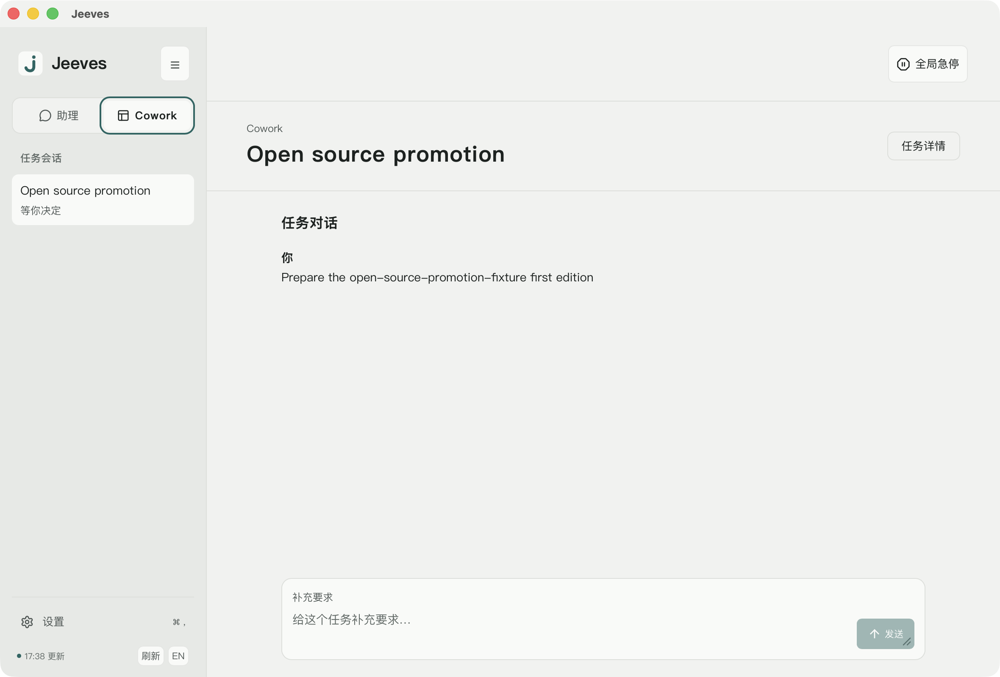

[English](README.md) | 简体中文

# Jeeves — 面向复杂长任务的超级个人助理

[](https://github.com/ChrisVip001/Jeeves/actions/workflows/ci.yml)
[](LICENSE)
[](https://github.com/ChrisVip001/Jeeves/releases/latest)

把要交付的结果告诉 Jeeves。例如，交办一次事故复盘，可以要求整理证据、核对数字并写出可供复核的报告。在主聊天里可以指定报告文件名、写明正文必须包含的原文。执行任务可以据此检查文件、补交缺少的内容，再把结果带回主聊天。从回执可以打开原任务继续跟进。[主聊天与任务会话](docs/design/main-entry.zh.md)

云端用户经统一网关登录。新工作区启动期间可以先写下要交办的事。Rust Runtime 按租户隔离任务与数据。源码可通过 `just local-up` 在本机浏览器使用。[架构](docs/architecture.zh.md) · [统一网关](gateway/README.zh.md) · [云端部署](control-plane/README.zh.md)

可以按公钥配对设备、撤销设备授权，见[设备协议](docs/protocol.zh.md#设备配对与撤销)。驾驶舱的[全局急停](docs/protocol.zh.md#全局急停)可冻结受管任务浏览器，重启后仍然生效。可从手机或桌面接管任务浏览器，并[将下载保存为该任务的产物](docs/protocol.zh.md#远程浏览器操作与下载)。

配对后的 iPhone 可通过[任务审批通知](docs/protocol.zh.md#任务审批通知)打开原任务，核对操作范围并决定是否允许。

在 Mac 上，可为一个任务[选择一个窗口](docs/protocol.zh.md#macos-单窗口操作)，点击按钮、填写字段、滚动列表，或预览截图并决定是否发送给屏幕模型。

> 多数 Agent 的记忆是个黑盒。Jeeves **每一轮对话只追加一行账本**：点开这一行，能看到这一轮的条目流——跑了哪些工具、哪个模型答的、花了多少 token。记忆库用 `ledger:…` 回溯到原始轮次，FTS5 索引能从账本重建。



编码任务可在独立 Git 工作目录中运行已获授权的命令行工具。父任务可以合入已完成子任务的检查点，并运行自己的最终测试。[编码任务协议](docs/protocol.zh.md)

## 安装

从仓库根目录运行 `just build`、`just check` 和 `just release-package`。参见[仓库布局](AGENTS.zh.md#仓库布局)。

**托管版**使用服务公开的 HTTPS 地址注册或登录。浏览器和 iOS PWA 共用一个账号与任务工作台。Mac 客户端用同一账号配对，在任务需要时授权操作所选窗口。[云端部署](control-plane/README.zh.md)

**单机自托管**可在仓库根目录运行 `just local-up`。首次在浏览器创建所有者账号，再连接模型。开发版 Mac App 和浏览器共用 `8743` 的 Go 网关。Runtime 的内部端口由系统分配。

```bash
just local-up          # 启动 Go 网关和私网 Runtime，并打开浏览器
just desktop-build     # 可选，打包 Mac 开发版
just desktop-open      # 已运行时回到原窗口
```

在主对话交办任务。从「我的事项」查看执行结果、逐行审阅文件，或继续任务。[上手指南](docs/guide.zh.md) · [Mac 桌面应用](docs/operations.zh.md#mac-桌面应用)

## Jeeves 能做什么

- **对话**：可通过终端、网页驾驶舱或聊天网关使用。[飞书对话和审批卡](docs/guide.zh.md#飞书--lark)
- **使用飞书业务能力**：官方 CLI 配合 `feishu-cli` 技能（`just install-feishu-cli`），复用现有命令执行权限和审批
- **记忆**：语义事实（FTS5、支持中文）、带日期的情景、过程 Skills，完整回合按用户消息在本地检索（[docs/architecture.zh.md](docs/architecture.zh.md)）
- **把记忆摊开给你看**：驾驶舱的记忆中心能翻账本、记忆库和上下文占用；`/compact [重点]` 可随时压缩（[docs/operations.zh.md](docs/operations.zh.md)）
- **行动**：23 个内置工具（15 个默认常驻，8 个在开关后面）外加 MCP 服务器（[docs/configuration.zh.md](docs/configuration.zh.md)）
- **接上日历和邮件**：CalDAV/ICS 只读；IMAP 用 `BODY.PEEK` 读信；SMTP 默认只写草稿，每个真实收件人与内容组合都要单独作用域授权并写回执，手机可查看 Mac Cowork 同一任务会话，并在主聊天答复带版本的发送审批。飞书入站事件先落盘再确认。主聊天可将排队中的任务邮件改为可恢复的草稿，普通聊天和任务发件的最终 SMTP 回执丢失均须核对（[docs/configuration.zh.md](docs/configuration.zh.md#日历与邮件)）
- **早上先看一份提议**：可开启 [08:00 晨报](docs/operations.zh.md#晨报cron-友好)，查看当日日程、未读邮件和回复草稿，以及未完成的任务。
- **花得少一点**：系统提示是「稳定前缀 + 每轮尾巴」，供应商能缓存；`JEEVES_TOOL_POLICY=deferred` 时请求里只放常驻工具的 schema（[docs/configuration.zh.md](docs/configuration.zh.md)）
- **长本事，但你说了算**：能力中心把技能、MCP 连接器和定时任务并排摆着，[连接管理](docs/guide.zh.md#连接状态)显示需要你处理的连接，可配置本地邮件/日历及发起支持的 OAuth 授权。可浏览精选目录、接入自定义 MCP 并逐工具启停。常驻运行时自动续期已绑定的 MCP OAuth 登录。MCP 工具的权限可以在[连接器清单](docs/configuration.zh.md#连接器清单)中配置。自己的可以加可以删，内置项只读。
- **按项目规矩干活**：从工作目录往上找 `AGENTS.md` / `AGENTS.override.md` / `CLAUDE.md`，拼进每轮尾巴（[docs/internals/06-app-server.zh.md](docs/internals/06-app-server.zh.md)）
- **不把做到一半的活扔回来**：步数用完而待办未完时继续，最多 `JEEVES_AUTO_CONTINUE_MAX` 次（[docs/configuration.zh.md](docs/configuration.zh.md)）
- **被检验**：确定性 eval 与回放 eval 把守每次发布；judge 给回答质量打分（[docs/internals/08-quality.zh.md](docs/internals/08-quality.zh.md)）

### 内置工具

| 工具 | 用途 |
|---|---|
| `memory` | `action` = save / forget / search / list / update / delete / delete_episode / create_skill |
| `send_message` | 消息草稿进 outbox，从不真的发送 |
| `search_web` | 优先 Parallel MCP，有上限地内置兜底；保留来源与相关段落 |
| `read_page` | 读目录里某一条的全文：记忆库一页或一个技能的完整步骤；默认开 |
| `read_file` | 读文本文件，分页并带行号；默认开 |
| `glob` | 列目录，或按文件名模式找文件；默认开 |
| `grep` | 搜文件内容，返回 `path:line: 文本`；默认开 |
| `find_symbol` / `repo_map` | 有界 FTS5 代码声明导航；默认开（[详情](docs/internals/04-tools.zh.md#文件读查找写补丁)） |
| `fetch_url` | 抓取网页：优先 Parallel MCP 提取，本地 HTTP 兜底并校验公开目标 |
| `job` | 读、列、停后台作业（`action` = output / list / kill）；`JEEVES_EXEC=1` 才有 |
| `todo_write` | 维护一张每轮重新注入的待办清单 |
| `write_file` / `edit` | 写文本文件 / 一次精确匹配替换；`JEEVES_WRITE=1` 才开，范围限于会话工作目录加 `JEEVES_EXEC_WRITABLE_ROOTS` |
| `apply_patch` | 按补丁跨文件修改，全中才落盘；与 `write_file` 同一范围与审批 |
| `run_command` | 沙箱 + 放行表的 shell 命令；`JEEVES_EXEC=1` 才开（见 [SECURITY.zh.md](SECURITY.zh.md)） |
| `delegate_task` | 把自成一体的活交给子代理；`JEEVES_DELEGATE=1` 才开 |
| `browser_observe` / `browser_act` | 可选任务浏览器，单次确认、人工接管；需要安装浏览器组件 |
| `find_tools` | 在延迟加载的工具里搜索，并在本会话里打开命中的工具；默认开 |
| `schedule_job` | 新建或覆盖一个定时任务：名字、五段 cron、一句话；默认开 |
| `list_schedules` | 列出已声明的任务及其 cron 与提示词；默认开 |
| `cancel_schedule` | 按名字删掉一个文件声明的任务；默认开 |

工具失败会以文本返回给模型，循环不会因此崩溃。

### 模型与密钥

内置 12 家 LLM 厂商预适配（`jeeves-provider`），含本地 Ollama。`<home>/models-catalog.json` 可补丁内置默认值或新增一家，`scripts/gen_catalog.py` 从 [models.dev](https://models.dev) 生成这些行（[docs/configuration.zh.md](docs/configuration.zh.md)）。终端里 `/model` 看已配好的套，`/model add ds deepseek deepseek-flash --env DEEPSEEK_API_KEY` 加一套，`/model use ds` 切过去，不用重启；Web 与桌面端偏好设置里有同样的模型菜单。每个模型 profile 显式指定凭据来源（[SECURITY.zh.md](SECURITY.zh.md)）。`JEEVES_OPS_HOST=0.0.0.0` 时启动强制要求 `JEEVES_OPS_TOKEN`（[docs/operations.zh.md](docs/operations.zh.md)）。

## 文档

| 文档 | 内容 |
|---|---|
| [docs/guide.zh.md](docs/guide.zh.md) | 上手指南：安装、向导、模型、权限、聊天网关、技能 |
| [docs/architecture.zh.md](docs/architecture.zh.md) | 原则、crate 依赖图、turn 数据流、设计决策 |
| [docs/protocol.zh.md](docs/protocol.zh.md) | JSON-RPC 方法、人工责任控制与带来源的飞书周报、通知序列与错误码 |
| [docs/configuration.zh.md](docs/configuration.zh.md) | 运行设置、模型密钥轮换与故障恢复、全部 `JEEVES_*` 变量 |
| [docs/operations.zh.md](docs/operations.zh.md) | 运行手册：各种运行形态、备份、故障排查 |
| [docs/limitations.zh.md](docs/limitations.zh.md) | 已知边界，每条都指出下一步该打开哪个文件 |
| [docs/internals/](docs/internals/README.zh.md) | 实现原理教程，一层一章 |
| [CONTRIBUTING.zh.md](CONTRIBUTING.zh.md) | 贡献指南：工程纪律与提交规则 |
| [SECURITY.zh.md](SECURITY.zh.md) | 安全模型：凭证、能力边界、OAuth |
| [CHANGELOG.zh.md](CHANGELOG.zh.md) | 更新日志 |

## 命名

| 用途 | 名字 |
|---|---|
| GitHub 仓库 | `ChrisVip001/Jeeves` |
| Rust CLI crate | `jeeves-cli` |
| Rust crate 前缀 | `jeeves-` |
| CLI 二进制 | `jeeves` |
| 助手人格 | Jeeves |
| 环境变量 | `JEEVES_*` |
| 状态目录 | `.jeeves/` |

[English](README.md) | 简体中文 · Code is MIT.
