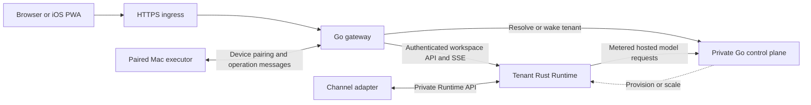

# Architecture

English | [简体中文](architecture.zh.md)

Jeeves runs complex, long-lived assignments on one Runtime per task store. Its `JEEVES_HOME` holds persistent task state on the chosen host. The Runtime calls configured model providers and routes tool operations to their executors. This document describes the
software structure; running and configuring it live in
[operations.md](operations.md) and [configuration.md](configuration.md). The
per-layer implementation tutorial is under `docs/internals/`.

## Design principles

1. **Rust owns logic and state.** The agent loop, memory, tools, and the
   SQLite state store live in Rust; crates are split by responsibility
   (target: <500 lines per module).
2. **The protocol has one definition.** `jeeves-protocol` is the single
   source of truth for the cross-language contract: `ts-rs` emits TypeScript,
   `schemars` emits JSON Schema, and the artifacts are checked in.
3. **One engine, many shells.** `jeeves-app-server` owns the whole turn and is the
   only executing runtime for a given `state.db`. The memory MCP opens the same database for memory operations, and home export opens it for a consistent snapshot. The private HTTP API (`jeeves-ops`) spawns it as a subprocess
   and speaks newline-delimited JSON-RPC over stdio; the chat gateways reach it through its
   private HTTP endpoint (`/api/gateway/rpc`). Native CLI commands embed the same
   runtime in-process. A runtime takes an OS advisory lock on the canonical database path
   before recovery, so a second execution runtime on the same database fails visibly.

## Multi-tenancy

A tenant has one workspace with a Rust Runtime started on demand. The ingress forwards client
traffic to the [Go unified gateway](../gateway/README.md), which owns user
accounts, sessions and Runtime routing. The private [Go control plane](../control-plane/README.md)
reconciles one Pod and one persistent volume per tenant and meters platform model usage. The
Runtime retains chat, tasks, checkpoints, memory and outputs in its own `JEEVES_HOME`. A source
installation runs the same gateway and Runtime on loopback through `just local-up`.

The hosted request path and adjacent services are:



In a source installation, the Go gateway listens on loopback port 8743 by default.
The Runtime publishes its assigned loopback port in `<home>/runtime-endpoint.json`.
The gateway verifies the Runtime instance before forwarding requests with its service credential.
See [shared Mac and Web development](operations.md#mac-desktop-app).

Engine-side pieces a host relies on:

* `GET /healthz` answers 200 with `status`, `version` and `protocolVersion` (a bounded
  `session/capabilities` round trip), or 503.
* Capacity caps: `JEEVES_MAX_TURNS` refuses a new turn when that many are already running;
  `JEEVES_HOME_MAX_MB` refuses a new turn when the home directory is over the cap. Both are
  off at 0; reads, exports and cleanup keep working.
* `jeeves home export <dir>` / `jeeves home import <dir>` move a home (backup, another machine,
  local to cloud): a consistent `state.db` snapshot plus the other files, with a manifest.
  Lock files, `secrets.json`, `mcp-auth/` and `connector-auth/` are left out; keys and
  sign-ins are given again after an import.
* SIGTERM (what a container runtime sends) drains running turns for up to 25 seconds.

## Module responsibilities

Cargo, Go and npm use their workspace or module manifests at the repository root.

| Source | Responsibility |
| --- | --- |
| [gateway/](../gateway/README.md) | Public Go entry for sign-in, account sessions, workspace routing and device pairing. Serves the Web build. |
| [control-plane/](../control-plane/README.md) | Private Go service for tenant provisioning, resource limits and hosted model metering. |
| [internal/cloudkit/](../internal/cloudkit) | Shared Go code for HTTP, persistence and Runtime endpoints. |
| [runtime/crates/](../runtime/crates) | Rust execution engine, persistent state, private HTTP API, CLI and eval runner. |
| [protocol/](../protocol) | Rust wire types, checked-in JSON Schema and TypeScript bindings, plus shared TypeScript event transport helpers. |
| [web/](../web) · [desktop/](../desktop) | Browser and iOS PWA workbench, plus the Tauri Mac device app and source-development shell. |
| [integrations/channels/](../integrations/channels) | Feishu, Telegram and WeChat adapters and their Node Runtime client in `runtime-client/`. |
| [executors/browser/](../executors/browser) | Task browser worker launched and supervised by the Runtime. |

Inside `runtime/crates/jeeves-app-server`, `server/` holds shared server state (`runtime.rs` boot and recovery,
`tools.rs` tool assembly, `controls.rs` approvals, capacity and active-turn control,
`settings.rs` configuration access); `dispatch.rs` and `stdio.rs` route JSON-RPC methods;
`turn/` is one turn (entry, execution, continuation, finalization, history, prompt assembly,
operation review); `task/` is the independent-task worker; `interaction/` is the main
conversation entry; `scheduler/` fires jobs; `memory_worker.rs`, `ledger_writer.rs` and
`memory_center.rs` are the background memory worker, the ledger writer and the memory-center
read surface. HTTP handlers live under `jeeves-ops/src/api/`, grouped by resource.

## Crate dependency graph

Arrows read "depends on" (taken from the crates' `Cargo.toml`):

```
jeeves-protocol          the contract (TS + JSON Schema artifacts); no internal deps
jeeves-state             SQLite + FTS5(trigram), sqlx migrations; no internal deps
jeeves-config            JEEVES_* variables, read once at boot            → protocol
jeeves-provider          12 providers, three wire formats + SSE        → config, protocol
jeeves-memory            retrieval, consolidation, compaction, Skills       → provider, state
jeeves-agent             deterministic helpers (acceptance checks,     → protocol, provider, state
                         plans, path containment)
jeeves-tools             tool registry + built-in tools                → agent, memory, provider, state
jeeves-loop              the agent loop                                → provider, state, tools
jeeves-mcp               MCP client + OAuth + memory server            → state, tools
jeeves-connector         calendar/email/Feishu connectors               → config, state, tools
jeeves-app-server        turns, tasks, recovery, JSON-RPC              → all of the above
jeeves-ops               private HTTP API (axum + SSE); spawns        → config, connector, mcp, memory, protocol
                         the app-server subprocess
jeeves-eval              deterministic evals, judge, release gate      → app-server, config, memory, protocol, provider, state, tools
jeeves-cli               the `jeeves` binary                              → app-server, ops, eval and the rest
```

Dependencies point one way and never cycle. `jeeves-eval` drives the core through the same
public API (`Server`, `run_turn`, `install_provider`) as every client: whatever an eval can
drive black-box, any frontend can.

## Data flow of one turn

```
user message
  → [memory retrieval] facts + episodes (FTS5, top_k) → the prompt tail
  → [Skills] catalog every turn (name + one line); bodies only on a match
  → [prompt assembly] stable prefix (soul + model identity + conversation rules)
      + per-turn tail (clock · capability note · todo · project conventions ·
      memory hits · catalogs · summary)
      the prefix is byte-identical within a session: that is the cache boundary
  → [THE LOOP] observe → reason → act → repeat
        · every model call races the cancellation token (turn/interrupt)
        · every tool execution races it too; errors return as text
        · the last allowed step is a wrap-up: tools go away, the model summarizes
  → [ledger] every row appended (user / assistant / tool_use / tool_result);
      payloads over JEEVES_LEDGER_INLINE_MAX spool to <home>/ledger/
  → [persist] conversation + meta (tools/model/usage) into chat_log
  → [consolidation] every N turns, a small model distills facts + an episode
  → [bundle] the background worker writes those into <home>/memory/ and reindexes
  → [trace] traces/<date>.jsonl
  → [notifications] turnStarted → textDelta → toolStarted → toolCompleted →
      consolidationCompleted → turnCompleted
```

The full notification set is in [protocol.md](protocol.md#turnstart-notification-sequence).

Consecutive acceptance and goal rounds carry the original human assignment alongside the latest feedback. The checkpoint stores the assignment separately from the current model transcript so recovery can continue the correct round and preserve the user’s request in history.

## Key mechanisms

### State (jeeves-state)

One `state.db`: `facts` / `episodes` (each with an FTS5 trigram index and sync triggers),
`chat_log` and `sessions` (a session row holds name, working directory and fork origin; the
body is `chat_log`), the append-only `ledger`, task / run / checkpoint / operation tables, and
more. Migrations are embedded at compile time via `sqlx::migrate!`, so the binary carries
its own schema. Queries in spaceless scripts (Chinese, Japanese, Korean) are cut into
overlapping two-character terms and ranked by how many each row contains; other queries go
through FTS5 trigram with a LIKE fallback. The memory backend contract lives in `store.rs`:
the `SemanticStore` / `EpisodicStore` traits plus `conformance` verification; a second
backend means implementing the traits and running the same tests.

### Memory (jeeves-memory)

* **Retrieval** searches local facts and episodes on each fresh turn. When either index
  is unavailable, the other still supplies context. The turn can proceed without memory
  if both are unavailable.
* **Consolidation**: every N turns (`JEEVES_CONSOLIDATE_EVERY`), unconsolidated dialogue is
  distilled into facts (source-labelled) and one episode; failure never loses the raw log.
* **Compaction**: turns pushed out of the working-memory window are folded into a rolling
  per-session summary (stored in `context_rollups`, carried forward, never recomputed from
  scratch). A dead summarizer falls back to a deterministic excerpt, so eviction never means
  amnesia.
* **Skills (procedural memory)**: `SKILL.md` (Agent Skills format) with progressive
  disclosure: frontmatter is scanned every turn, the body enters the prompt only when the
  message matches.
* **The bundle (derived knowledge)**: the background worker distils facts into
  `<home>/memory/` pages (OKF shape, one concept per file) and keeps an FTS5 index over
  them. The prompt carries the catalog, not the pages; the model pulls one with `read_page`.
  A person may edit a page by hand; the next `jeeves memory rebuild` takes the file as truth.
* **Ledger first**: every turn is appended to the `ledger` table row by row (digest per row,
  oversized payloads spooled under `<home>/ledger/`), and the memory center reads turns back
  from it.

### Context budget (what actually reaches the model)

Everything the model sees each turn is assembled once, in `build_system`, and measured by
the memory center's meter:

| Section | Where it comes from | Knob |
|---|---|---|
| soul | `SOUL.md` (thin or full) | `JEEVES_SOUL_MODE` |
| memory | retrieval hits + the bundle catalog + the skill catalog | `JEEVES_RETRIEVAL_TOP_K` |
| skills | the bodies that matched this message | none |
| tools | JSON schemas of the registered tools | `JEEVES_TOOL_POLICY=deferred` shrinks it |
| history | the last N conversation turns from `chat_log` | `JEEVES_HISTORY_TURNS` |
| summary | the rolling compaction summary | `JEEVES_COMPACT_THRESHOLD` |

Four things in the tail are deliberately outside the six-section meter: the clock, the todo
board and the capability note (a few dozen constant tokens each), and **project conventions**
(`agents_md.rs`). From the turn's working directory up to the enclosing `.git`, one file per
directory is taken in order (`AGENTS.override.md`, `AGENTS.md`, `CLAUDE.md`) and concatenated
root-first. The total is capped at 32 KB and filled from the inside out: the file nearest the
workspace stays whole and the outer one is dropped (only when the innermost file alone is over
budget is it truncated, and the cut says so). It lives in the tail, never in the stable
prefix, because it changes with the directory. A subagent gets none of it. The band shows what
grows within a session, so in a repository with a fat `AGENTS.md` it understates the prompt by
that file (see [limitations](limitations.md#context)).

Three things keep the budget from quietly growing: compaction (above); tool-result trimming,
which stubs the oldest oversized results before each request (`JEEVES_TOOL_RESULT_TOTAL_CHARS`,
newest `JEEVES_TOOL_RESULT_KEEP_RECENT` kept whole); and the iteration budget, which bounds the
turn itself (`JEEVES_MAX_ITERATIONS`; the last step is a wrap-up).

### Tools (jeeves-tools)

Built-in tools and MCP tools merge into one `ToolRegistry` (the exact inventory is in
[internals/04-tools.md](internals/04-tools.md) and is checked against the code). The contract:
`execute` never returns Err. Errors return to the model as `Error: …` text and the loop keeps
going; a tool failure is information the model can correct, not a crash.

### Interruption (turn/interrupt)

Each turn registers a cancellation token; model calls and tool executions race it via
`tokio::select!`, and the losing future is dropped (the HTTP connection closes with it). A
partial reply is stored honestly with `meta.interrupted = true`.

### Mutation admission

Production tool registries share one host-injected mutation coordinator across sessions.
File mutations, commands, declarative commands and conservatively classified MCP calls hold a
single runtime permit; background commands keep it until process, output and ledger settle.
Reads and job inspection or cancellation stay available. Admission waits at most two seconds
and returns a visible tool error when busy.

This is single-writer coordination inside one runtime, not filesystem isolation or a
distributed lease: separate `JEEVES_HOME` runtimes, human editors and external processes can still
conflict.

### Main conversation and tasks

Web, the Mac development shell and connected chat channels use the persistent
`jeeves-main` session and `interaction/start`. The Runtime
routes a human message into ordinary discussion, clarification, or up to four independent
tasks, and owns admission, task directories, dispatch, retries and inherited permissions;
clients render the shared task controls. One worker by default (configurable up to eight) executes tasks while main-conversation
turns stay available. The main prompt carries bounded task progress, not worker transcripts.
Protocol details: [protocol.md](protocol.md#main-human-interaction).

### Evaluation (jeeves-eval)

Deterministic evals drive the same `run_turn` in-process with a scripted model: offline, 0/1,
reproducible, scenarios in `evals/deterministic/*.jsonl`. **Every applicable case outside a declared known gap must pass**
(the exit code of `jeeves eval`). A broken case setup fails the gate even when marked as a known gap. Report storage is best effort. The judge has a real model answer and a cheaper model grade
0-10 against a rubric; scores are reported and never block a release. Reports land in
`eval_report.json`, history appends to `eval_runs.jsonl`.

## Security boundaries

Model profiles select their credential source explicitly. See [credential handling](../SECURITY.md#credential-handling). Responses and logs carry only a pointer to where a key lives.
MCP OAuth tokens land in `mcp-auth/` (0600, temp file then atomic rename). `send_message`
only drafts; skill names are forced slugs against path traversal. The complete list is in
[SECURITY.md](../SECURITY.md).

## Design decisions

### Why Chinese search needed its own migration

FTS5's default `unicode61` tokenizer treats a run of Chinese as one token, so "早上" never
matches "Alex likes morning meetings". The `0002_cjk_trigram` migration switches to `trigram`
(sliding three-character slices), which makes Chinese work naturally; queries trigram cannot
slice (two-character Chinese words are common) fall back to a LIKE substring scan. A
personal memory store is a few thousand rows, so one full-table LIKE costs microseconds.

### Why generated artifacts are checked in

"Changed the Rust protocol, forgot to regenerate" never errors and only makes frontends read
stale types. Committing the artifacts puts that drift in the PR diff; CI gates it with
`--check`.

### Why generation code compiles only under test

`jeeves-protocol`'s runtime dependencies are `serde`, `serde_json` and
`jeeves-protocol-noop-macros`; `ts-rs` and `schemars` are dev-dependencies:

```rust
#[cfg(test)]      pub(crate) use ts_rs::TS;
#[cfg(not(test))] pub(crate) use jeeves_protocol_noop_macros::TS;   // empty macro
```

So `cargo build` never touches the generators and the binary carries none of them.

## Three layers of memory

* **The ledger is the fact.** The `ledger` table, append-only: each turn's user / assistant /
  tool_use / tool_result rows, every row with a `digest` over its canonical payload. Payloads
  over `JEEVES_LEDGER_INLINE_MAX` move to `<home>/ledger/…` and the row keeps a pointer, digest
  and byte count. Any turn can be rebuilt from it. Rows that came through
  `jeeves memory backfill` carry `fidelity: folded`, the honest label for "this tool output only
  exists as a summary".
* **The bundle is derived knowledge.** `<home>/memory/` in OKF shape: one Markdown page per
  concept, frontmatter carrying `title` / `kind` / `sources`, `index.md` as the catalog,
  `changelog.md` as the history. When a person edits a page, its digest no longer matches the
  index and the next `jeeves memory rebuild` takes the file as truth.
* **The index is a cache.** SQLite FTS5 for memory retrieval. Losing it costs a
  reindex, never a fact.

The prompt carries the catalog of the first two layers, not the encyclopedia: the model
sees a table of contents and pulls pages on demand (`read_page`), the same progressive
disclosure as the skill catalog and the deferred tool table.
